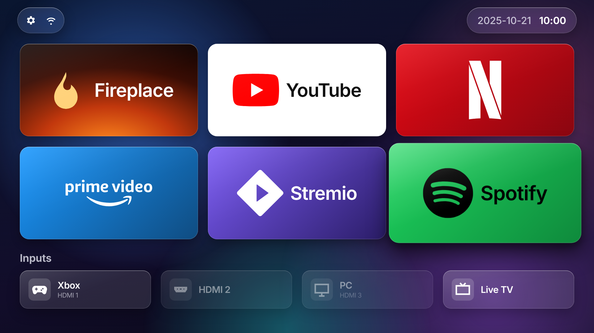
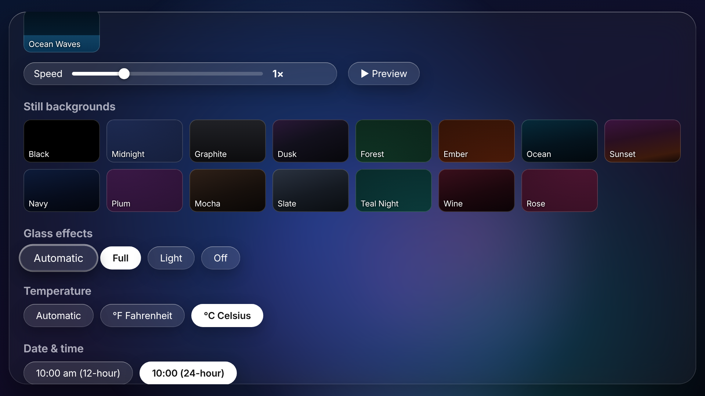
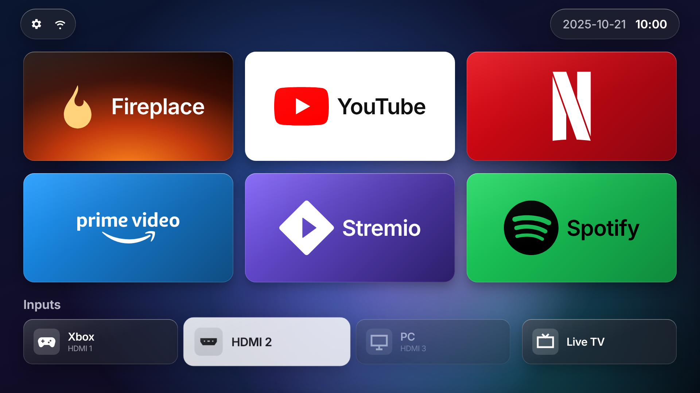

# LiquidGlassTizen

**Tu tele Samsung, sin anuncios y con la pantalla de inicio Liquid Glass.**



Enciendes la tele para ver una película y lo primero que te recibe es un escaparate: "Top Picks for You", Samsung TV Plus arrancando solo y una fila de apps que nunca pediste. Además, la tele va tomando nota de lo que ves.

LiquidGlassTizen lo arregla en dos partes:

- 🖥️ **Un lanzador para la tele** que sustituye la pantalla de inicio de Samsung. Se abre al encender y vuelve cuando pulsas Home.
- 💻 **Una herramienta para tu ordenador** (`lgtizen`) que prepara la tele, instala el lanzador y te enseña qué apps de fábrica sobran.

No necesitas Tizen Studio, ni root, ni pelearte con un SDK de varios gigas.

## Qué trae

**En la tele**

- 🫧 **Aspecto Liquid Glass**, al estilo de Apple TV: barras de cristal esmerilado flotando sobre el fondo, iconos con bordes redondeados y un brillo que los recorre, y el foco que *levanta* la app hacia ti en lugar de pintarle un borde. Tienes cuatro modos en Ajustes:
  - **Automático:** la tele lo decide sola la primera vez que arranca. Si va fluida, usa Completo.
  - **Completo:** desenfoque real del fondo detrás de cada panel.
  - **Ligero:** el mismo diseño con un tinte más denso, para teles antiguas o lentas.
  - **Apagado:** el aspecto plano original.
- 🧩 Tus apps en una cuadrícula de 3 columnas, con sus logos de verdad.
- 🔌 Las entradas HDMI debajo, con el nombre de lo que tienes enchufado. Puedes renombrarlas ("Xbox del salón", "La Play de Lucas").
- ✋ Mantén OK sobre una app para moverla a donde quieras.
- 🌌 31 fondos, 16 animados (aurora, lava, nieve, lluvia, olas...), con control de velocidad y vista previa.
- 🌤️ Hora, fecha, tiempo y tu ciudad arriba, en el formato que prefieras.
- 📶 Un icono que te dice si vas por cable o por Wi-Fi, y con cuánta señal.
- 🔥 Una chimenea para las noches de invierno (vídeo en YouTube, o una animada si no tienes YouTube).
- ⚙️ Ajustes para elegir qué apps se ven, abrir la tienda de Samsung o volver al inicio de Samsung si lo echas de menos.

**En tu ordenador**

- 🔎 Encuentra la tele en tu red.
- 🔐 Crea los certificados de Samsung para tu tele (inicias sesión una vez en tu cuenta Samsung).
- 📦 Firma e instala cualquier app `.wgt`, incluido el lanzador.
- 🧹 Lista las apps instaladas, marca las que sobran y las quita si tu firmware lo permite.

| Ajustes de cristal | Entradas HDMI |
|---|---|
|  |  |

Los nombres de dispositivos y el tiempo de las capturas son de ejemplo.

## Instalación paso a paso

No hace falta saber informática. Solo hay que seguir los pasos en orden y copiar y pegar lo que se indica. Calcula unos **30 minutos** la primera vez.

### Antes de empezar, ten a mano

- ✅ **Tu tele Samsung** (de 2020 en adelante) encendida y conectada a Internet.
- ✅ **Un ordenador** (Windows, Mac o Linux) conectado **a la misma red** (al mismo router o Wi-Fi) que la tele.
- ✅ **Una cuenta Samsung** (es gratis; puedes crearla en [account.samsung.com](https://account.samsung.com) si no tienes).
- ✅ **El mando de la tele.**

> 💡 **Cómo leer esta guía:** los recuadros grises son órdenes. Cópialas tal cual (con el botón de copiar que aparece al pasar el ratón) y pégalas en la "terminal", una ventana donde se escriben órdenes. En el paso 2 te explicamos cómo abrirla. Cuando haya dos versiones, usa la de tu sistema: **Windows** o **Mac / Linux**.

---

### Paso 1. Instala Python en tu ordenador (solo la primera vez)

Python es el programa que hace funcionar la herramienta.

**Windows**

1. Entra en [python.org/downloads](https://www.python.org/downloads/) y pulsa el botón amarillo **Download Python**.
2. Abre el archivo descargado.
3. ⚠️ **Muy importante:** en la primera pantalla, marca la casilla **"Add python.exe to PATH"** (abajo del todo) **antes** de pulsar **Install Now**.
4. Cuando termine, pulsa **Close**.

**Mac**

1. Entra en [python.org/downloads](https://www.python.org/downloads/) y pulsa **Download Python**.
2. Abre el archivo `.pkg` descargado y pulsa **Continuar** hasta terminar.

**Linux:** casi siempre ya viene instalado. Si en el paso 3 te da error, instala los paquetes `python3` y `python3-venv` desde el gestor de software de tu sistema.

---

### Paso 2. Descarga LiquidGlassTizen y abre la terminal en su carpeta

1. Descarga el programa desde este enlace: **[LiquidGlassTizen-main.zip](https://github.com/yeraydirod/LiquidGlassTizen/archive/refs/heads/main.zip)**
2. Ve a tu carpeta **Descargas** y descomprime el archivo:
   - **Windows:** clic derecho sobre el ZIP → **Extraer todo** → **Extraer**.
   - **Mac:** doble clic sobre el ZIP.
3. Se crea una carpeta llamada **`LiquidGlassTizen-main`**. Ahora abre la terminal **dentro de esa carpeta**:
   - **Windows:** entra en la carpeta `LiquidGlassTizen-main`, haz clic en la barra de direcciones de arriba (donde pone la ruta), escribe `cmd` y pulsa **Enter**. Se abre una ventana negra.
   - **Mac:** abre **Terminal** (búscala con ⌘ + espacio), escribe `cd ` (con un espacio al final), **arrastra la carpeta** `LiquidGlassTizen-main` a la ventana y pulsa **Enter**.
   - **Linux:** abre la carpeta, clic derecho en un espacio vacío → **Abrir en una terminal**.

> 💡 Deja esta ventana abierta durante toda la instalación. Si la cierras, vuelve a abrirla igual que en el punto 3.

---

### Paso 3. Instala la herramienta (solo la primera vez)

Copia y pega estas dos líneas en la terminal, pulsando **Enter** después de cada una. La segunda tarda un minuto y escribe bastante texto; es normal.

**Windows**

```
py -m venv .venv
.venv\Scripts\python -m pip install .
```

**Mac / Linux**

```
python3 -m venv .venv
.venv/bin/python -m pip install .
```

✔️ **Ha ido bien si** la última línea empieza por `Successfully installed`.

Ahora comprueba que encuentra tu tele (con la tele encendida):

**Windows**

```
.venv\Scripts\python -m lgtizen discover
```

**Mac / Linux**

```
.venv/bin/python -m lgtizen discover
```

✔️ **Ha ido bien si** aparece una línea con el nombre y el modelo de tu tele, por ejemplo `{"ip": "192.168.1.50", "name": "Samsung 65\" TV", ...}`. **Apunta el número que va después de `"ip"`**: es la dirección de tu tele.

> ❓ ¿No aparece nada? Mira [Si algo falla](#si-algo-falla).

---

### Paso 4. Averigua la dirección (IP) de tu ordenador

La tele necesita saber qué ordenador tiene permiso para instalarle cosas.

- **Windows:** en la terminal escribe `ipconfig` y pulsa Enter. Busca la línea **Dirección IPv4** (o *IPv4 Address*). Es algo como `192.168.1.34`.
- **Mac:** menú **Apple** (la manzana, arriba a la izquierda) → **Ajustes del Sistema** → **Wi-Fi** (o **Red**) → botón **Detalles…** junto a tu red. Ahí aparece **Dirección IP**.
- **Linux:** escribe `hostname -I` y usa el primer número.

✍️ **Apúntala**: la necesitas en el paso siguiente.

---

### Paso 5. Activa el modo desarrollador en la tele

1. En la tele, pulsa el botón **Home** del mando y entra en **Apps** (Aplicaciones).
2. Con la pantalla de Apps abierta, teclea **1 2 3 4 5** en el mando.
   - Si tu mando no tiene números, pulsa el botón **123** (en algunos mandos es el botón de los **colores**) para que salga un teclado numérico en pantalla.
3. Aparece la ventana **Developer Mode**. Ponlo en **On**.
4. En **Host PC IP**, escribe la IP de tu ordenador que apuntaste en el paso 4. Pulsa **OK**.
5. ⚠️ **Muy importante:** **desenchufa la tele de la corriente**, espera **un minuto** y vuelve a enchufarla. Apagarla con el mando **no sirve**.

Comprueba que se ha activado:

**Windows**

```
.venv\Scripts\python -m lgtizen status
```

**Mac / Linux**

```
.venv/bin/python -m lgtizen status
```

✔️ **Ha ido bien si** en el resultado aparece **`developerMode=1`**.

---

### Paso 6. Crea los certificados (solo la primera vez)

Samsung solo deja instalar apps firmadas con un certificado de tu cuenta. Este paso lo crea automáticamente.

**Windows**

```
.venv\Scripts\python -m lgtizen certs
```

**Mac / Linux**

```
.venv/bin/python -m lgtizen certs
```

1. Se abre tu navegador con la página de **inicio de sesión de Samsung**.
2. Entra con tu cuenta Samsung (tu email y contraseña de Samsung).
3. Cuando la página diga **"Signed in. You can close this tab."**, cierra la pestaña y vuelve a la terminal.

✔️ **Ha ido bien si** la terminal dice `Certificates for TV ... saved to ...`.

> 🔒 Los certificados se guardan en tu ordenador y solo los puede leer tu usuario. No se envían a nadie más que a Samsung.

---

### Paso 7. Instala LiquidGlassTizen en la tele

**Windows**

```
.venv\Scripts\python -m lgtizen install launcher
```

**Mac / Linux**

```
.venv/bin/python -m lgtizen install launcher
```

✔️ **Ha ido bien si** la última línea dice **`Installed: LqGlass001.Home`**.

Ahora **reinicia la tele** (o ábrela desde **Apps → LiquidGlassTizen**). 🎉 Desde ahora la tele arranca en LiquidGlassTizen y el botón **Home** te devuelve a ella.

---

### Paso 8. Personalízala

En la tele, sube con el mando hasta la **rueda dentada ⚙️** (arriba a la izquierda) y pulsa **OK**. Desde ahí puedes:

- Elegir **fondo** y su velocidad.
- Cambiar los **efectos de cristal** (si notas la tele lenta, elige **Light**).
- Elegir qué **apps** aparecen en el inicio. Para **moverlas**, en el inicio mantén pulsado **OK** sobre una app y usa las flechas.
- Poner nombre a tus **entradas HDMI** ("Xbox", "Decodificador"...).

**¿Quieres quitar apps de fábrica que no usas?** Desde la carpeta del paso 2:

| Windows | Mac / Linux |
|---|---|
| `.venv\Scripts\python -m lgtizen apps` | `.venv/bin/python -m lgtizen apps` |
| `.venv\Scripts\python -m lgtizen debloat` | `.venv/bin/python -m lgtizen debloat` |

El primero solo te enseña la lista. El segundo te pregunta cuáles quitar y te pide confirmación antes de borrar nada. Las apps importantes del sistema están protegidas y no se pueden borrar por error.

> **¿Vienes de AeroTizen?** La primera vez se copian tus certificados de `~/.config/aerotizen`, así que puedes saltarte el paso 6. Después quita el lanzador antiguo para que no se peleen por el botón Home: `... -m lgtizen debloat --remove DclHome001` (el paso 7 te lo recuerda si sigue instalado).

---

### ¿Quieres volver a la pantalla de Samsung?

- **Un momento:** en Ajustes ⚙️, baja del todo y elige **"Use Samsung Home instead"**. Volverá LiquidGlassTizen la próxima vez que la abras o reinicies la tele.
- **Para siempre:** en la tele ve a **Apps → ⚙️ Ajustes (arriba a la derecha) → LiquidGlassTizen → Eliminar**.

---

### Si algo falla

| Lo que ves | Qué significa | Qué hacer |
|---|---|---|
| `'py' no se reconoce...` o `python3: command not found` | Python no está instalado, o en Windows no marcaste "Add to PATH" | Repite el paso 1. En Windows, al abrir el instalador elige **Modify** o desinstala y vuelve a instalar marcando la casilla |
| `No module named venv` o un error con `ensurepip` (Linux) | Falta un paquete de Python | Instala `python3-venv` y repite el paso 3 |
| `discover` no muestra nada | El ordenador no ve la tele | Comprueba que la tele está encendida y en la **misma red**. Si aun así no sale, busca la IP de la tele en **Ajustes → General → Red → Estado de la red → Ajustes de IP** y añade `--tv` con esa IP a cada orden, por ejemplo `... -m lgtizen --tv 192.168.1.50 status` |
| `developerMode=0` en el paso 5 | El modo desarrollador no se ha aplicado | Repite el paso 5 y **desenchufa** la tele un minuto (no vale apagar con el mando) |
| `cannot reach ...:26101` o `TV closed the connection during handshake` | La tele no reconoce a tu ordenador | La IP del paso 4 no coincide con la de **Host PC IP** (a veces el router cambia la IP del ordenador). Mira tu IP otra vez, corrígela en la tele (paso 5) y desenchúfala de nuevo |
| `Samsung sign-in did not complete` | No terminaste el inicio de sesión en 5 minutos | Repite el paso 6. Si vuelve a fallar, usa `... -m lgtizen certs --fixed-state` |
| `No certificates for this TV yet` | Falta el paso 6 | Haz el paso 6 y luego el 7 |
| `NOT installed` | La tele rechazó la instalación | Repite el paso 7. Si sigue igual, vuelve a crear los certificados con `... -m lgtizen certs --force` y repite el 7 |
| `STILL PRESENT` al quitar apps | Tu tele no deja borrar esa app desde el ordenador | Bórrala en la tele: **Apps → ⚙️ Ajustes → elige la app → Eliminar** |
| `The TV's certificate is not the one seen before` | La tele ha cambiado su certificado, normalmente tras una actualización o un reinicio de fábrica | Borra el archivo que indica el mensaje y repite la orden |

¿Sigue sin funcionar? [Abre un issue](../../issues/new) y pega lo que aparece en la terminal y el modelo de tu tele. ¡Te echamos una mano!

## Más limpieza, sin ordenador

- 📋 [Guía de ajustes de la tele](docs/settings.md): qué apagar para quitar anuncios, el rastreo de lo que ves (ACR) y el arranque automático de TV Plus.
- 🛡️ [Listas DNS](dns/) para Pi-hole, AdGuard Home o NextDNS. Usa `samsung-ads.txt`.

> ⚠️ **Ojo con `samsung-aggressive.txt`.** Bloquea también el servidor de actualizaciones de Samsung, así que **tu tele dejará de recibir parches de seguridad**. Úsala solo si sabes lo que haces.

## Lo que no puede hacer (todavía)

Samsung no permite nada de esto oficialmente, así que hay trucos con letra pequeña:

- Al pulsar Home, el lanzador vuelve en uno o dos segundos. Funciona desde el inicio de Samsung y dentro de Netflix, pero no dentro de YouTube, Prime Video, Stremio o Spotify, porque esas apps no dicen si están en pantalla. El botón Atrás funciona siempre.
- En Tizen 6 o superior, las apps de la tienda y las preinstaladas no se pueden quitar desde el ordenador. Bórralas en la tele desde Apps → Ajustes. Las de sistema (TV Plus, Gaming Hub) solo se pueden desactivar.
- Las apps de la tele se dibujan a 1920×1080 y se escalan, incluso en un panel 4K. Solo el vídeo va a 4K real.
- Los menús propios de Samsung no se pueden cambiar.

## Probado en

| Tele | Año | Firmware |
|---|---|---|
| Samsung 65" Crystal UHD DU7200 (UN65DU7200FXZA) | 2024 | Tizen 9.0 |

Debería funcionar en teles Samsung de 2020 en adelante. Si lo pruebas en la tuya, [cuéntanos cómo te fue](../../issues/new).

## Seguridad y privacidad

El código se ha auditado y no envía nada a sus autores. Las únicas conexiones a Internet son los servidores oficiales de certificados de Samsung (al crear los certificados) y el tiempo: [ipapi.co](https://ipapi.co) para saber tu ciudad a partir de tu IP y [Open-Meteo](https://open-meteo.com) para la previsión. En [SECURITY.md](SECURITY.md) está lo que se ha reforzado respecto al proyecto original y lo que queda pendiente.

## Proyecto idea

LiquidGlassTizen nace de **[AeroTizen](https://github.com/helalaou/AeroTizen)**, de Hamza El Alaoui, publicado con licencia MIT. Él resolvió lo difícil: hablar con la tele sin Tizen Studio, firmar las apps y conseguir que un lanzador se comporte como pantalla de inicio. Gracias. 🙌

AeroTizen a su vez se apoyó en:

- [LTvLauncher](https://github.com/leanbitlab-org/LtvLauncher), inspiración del diseño.
- [Apps2Samsung](https://github.com/Apps2Samsung/Apps2Samsung) y [tizen-sdb](https://github.com/PatrickSt1991/tizen-sdb), para la conexión de desarrollador, los certificados y la firma.
- [samsung-tizen-tv-debloat](https://github.com/ardazeytin/samsung-tizen-tv-debloat), para saber qué paquetes se pueden quitar sin romper nada.
- Logos de [Simple Icons](https://simpleicons.org) (las marcas son de sus dueños).
- Fuente [Inter](https://rsms.me/inter/), con licencia SIL Open Font License (incluida en `launcher/fonts/`).

El aspecto está inspirado en el estilo de Apple TV, pero está hecho desde cero con CSS propio, sin fuentes, iconos ni código de Apple. Este proyecto no tiene relación con Samsung ni con Apple. Úsalo bajo tu responsabilidad.

## Licencia

[MIT](LICENSE). Se mantiene el aviso de copyright de AeroTizen junto al de LiquidGlassTizen.
